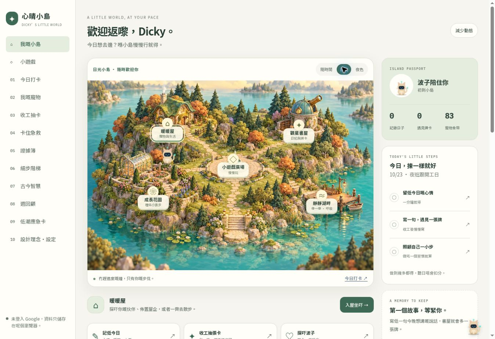
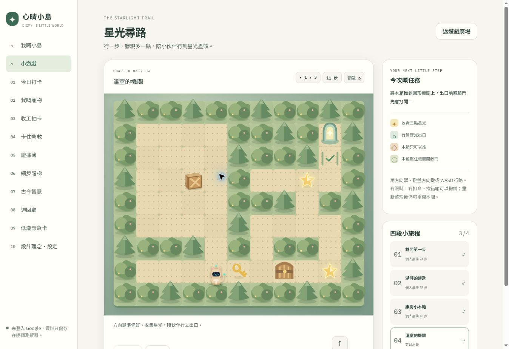

# 心晴小島 · Dicky 心晴手帳

可以寫日記、養伙伴、探索場景同玩解謎遊戲嘅自我照顧小島。原有打卡、證據簿、細步階梯、週回顧、26 張牌卡、寵物家庭同商店保留。



## 可以玩甚麼

- **星光尋路**：四關獨立地圖。控制伙伴行路，收集星光、搵鎖匙開門、推木箱、壓機關開藤門，再到出口過關。用方向鍵、WASD 或手機方向掣；Z／撤銷可以退一步。位置會自動儲存，重開網頁可續玩。每關首次完成有寵物時獎勵 12 金幣，重玩記錄最少步數。
- **找找小伙伴**：六對隨機洗牌，記住位置再配對；冇限時。每日頭兩局完成各有 5 金幣，之後仍可繼續玩。離開分頁保留當局，重新整理會重開。
- **拋波仔**：原有五球遊戲保留，修正離場後計時器同減少動態模式結算；拋波金幣獎勵限每日頭兩局。
- **探索與收藏**：五個地點、日／夜場景、首次探索明信片、17 個紀念章、按累積記錄日子成長嘅花園，同湖畔休息場景。



## 本機開發

純 HTML、CSS、JavaScript，執行網頁毋須編譯，沒有新增瀏覽器套件。開發時使用 Prettier 統一代碼格式。以靜態伺服器服務本資料夾，例如在本資料夾執行 `python3 -m http.server 8080`，再開啟 `http://localhost:8080`。直接部署時請保留 `index.html`、`css/`、`js/`、`assets/` 的相對位置。

```sh
npm ci
npm run check
npm test
```

開發與測試使用 Node.js 24。Firestore 規則測試另需 Java 21；詳見 [Firebase 設定與驗證](docs/FIREBASE.md)。這些套件只用於開發，網頁仍直接載入靜態檔案。格式整理：

```sh
npm ci
npm run format
npm run format:check
```

涉及 `mental-health-journal/` 或其 workflow 的 Pull Request（包括草稿）及 `main` 推送，會由 [Journal checks](../.github/workflows/mental-health-journal.yml) 在 Node.js 24 自動執行 `npm ci`、語法檢查、測試及格式檢查，並以 Java 21 執行 Firestore 規則模擬器測試。這套 workflow 只檢查程式，不部署網頁；合併前可在 PR 的 Checks 查看結果。

純格式化與邏輯修改請分開 commit，先提交格式整理，再提交重構或功能修改。日後有純格式化 commit，才建立 repo 根目錄的 `.git-blame-ignore-revs` 並記下完整 SHA；不要把同時改過邏輯的 commit 放入名單。本機 Git 如要使用該名單，需設定 `git config blame.ignoreRevsFile .git-blame-ignore-revs`。

主要模組：

| 檔案 | 職責 |
| --- | --- |
| `js/app.js` | 頁面、互動、繪圖及登入介面接線 |
| `js/auth.js` | Google 登入初始化、單一視窗、錯誤與登出流程 |
| `js/storage.js` | 本機儲存、復原、備份還原及帳戶同步；透過注入介面直接測試 |
| `js/core.js` | 共用核心欄位、資料檢查、成長及配對遊戲規則 |
| `js/sync.js` | 按帳戶依序送出待同步分區 |
| `js/adventure.js` | 解謎關卡、移動、存檔及獎勵規則 |

測試涵蓋關卡可達性、碰撞／推箱／機關、存檔、一次性獎勵、配對遊戲、備份驗證、花園成長及雲端寫入佇列。

## 資料與同步

- 沿用 `dicky-care-v1` 本機儲存，新 `journey` 欄位會自動補上；舊 JSON 備份仍可匯入。
- 打卡與抽卡草稿留在本瀏覽器，按帳戶及記錄日期分開。正式記錄同冒險進度可透過原有 Google 登入同步。
- 手帳改用獨立專案 `dicky-heartland-journal-2026`，資料路徑仍為 `users/{uid}/mentalHealthJournal`。既有手帳帳戶保留原 UID，舊專案資料保留；正式切換前須重跑搬遷，步驟與已驗證範圍見 [Firebase 設定與搬遷](docs/FIREBASE.md)。
- 匯入前驗證格式，顯示確認摘要，再建立本機安全副本；設定可下載匯入前副本。未能解析的舊資料亦會保留原始副本供下載。
- 開啟本機資料時逐項保留有效記錄與未知欄位；損壞項目不會令整份手帳重設。復原標記會隨本機儲存保留，重新開啟或離線打卡不會解除保護。
- 復原時須成功讀取伺服器及所有分區，才會合併打卡／抽卡並恢復雲端證據簿、寵物、習慣等資料。其餘本機修改先留副本，設定提供原始資料及復原前修改的下載入口；副本儲存失敗時不會覆寫或上傳預設資料。
- 下載備份後可按「已下載備份，收起提示」。這個選擇會保留；它只收起提示，不會刪除備份或解除尚未完成的雲端復原保護。再次發現資料損壞時會重新提示。
- 網絡恢復時會重新載入尚未連上的帳戶，或繼續送出已連線帳戶的待同步記錄。
- 原始資料、復原前修改、匯入前副本各有一個固定位置；雲端副本及帳戶暫存則每個帳戶各一份。重複操作會覆寫同一位置。帳戶暫存可能含未上傳記錄，因此不會自動刪除；大量舊資料或多個帳戶仍可能用盡瀏覽器空間。
- 本機寫入失敗會顯示持續提示。請在設定匯出 JSON，避免未保存的內容隨頁面關閉而失去。
- 雲端沿用 core 的時間戳合併策略，並非多人即時協作。避免同時開多個分頁或多部裝置修改同一份資料。
- 資料不會上傳至 GitHub；原始碼中的預設示例仍是公開內容。Firebase 同步不是端對端加密。

公開網頁的抽卡使用本機關鍵字選牌；寵物對話使用預設回應。遊戲和牌卡不是醫療評估，本工具不能取代專業評估或治療。

更多改動原因、測試範圍及後續項目見 [升級審閱記錄](docs/UPGRADE_REVIEW.md)。場景素材來源見 [美術說明](assets/README.md)。
