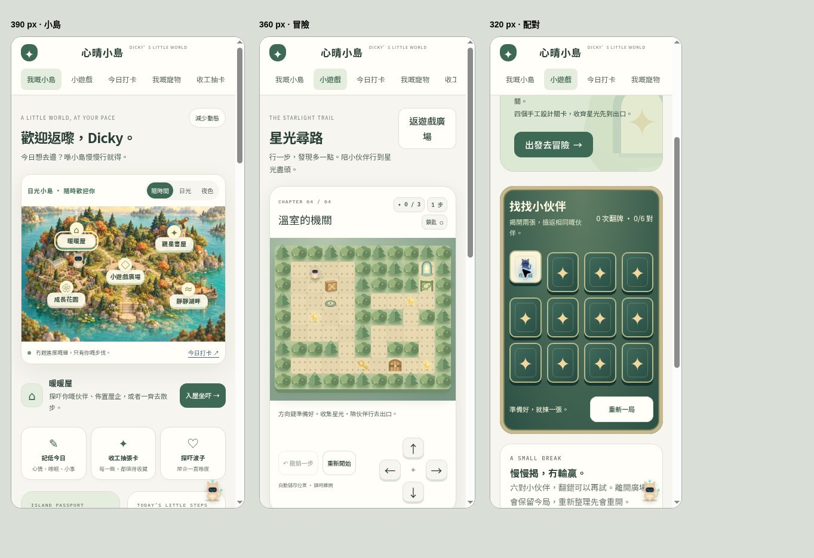

# 心晴小島升級審閱記錄

日期：2026-10-24。範圍只限 `mental-health-journal/`，以獨立分支提出 Pull Request，未合併或部署。

## 原版觀察與本次改動

| 原版觀察 | 本次處理 |
| --- | --- |
| 26 張 SVG 牌卡有完整插畫，寵物、房間及外出場景已有個性；主入口仍以表單分頁為主 | 保留原插畫和玩法，新增日夜小島、五個地點、湖畔場景與一致的森林綠／紙色介面 |
| 「玩」主要是短動畫，缺少一段可掌控的遊戲目標 | 「去玩遊戲」直達廣場；加入四關尋路推箱、鑰匙門、壓力機關及六對配對遊戲 |
| 記錄與收集分散在多個分頁 | 主頁顯示今日任務、伙伴護照、花園階段、紀念章及探索明信片；牌庫可搜尋和篩選 |
| HTML 超過三千行，樣式、狀態與遊戲混在同一檔 | 分離基礎與小島 CSS、原應用控制器、純遊戲規則、備份／成長規則、雲端佇列 |
| 拋球動畫離場後仍可能回呼；減少動態路徑結算不一致 | 統一五球結算，離場／背景／切換分頁取消動畫及延遲回呼；每日遊戲獎勵有限額 |
| 備份匯入直接覆蓋、抽卡月份未完整標記同步 | 加入格式與容量檢查、原生確認對話框、安全副本、舊／新年份及月份聯集同步 |
| 寫入 localStorage 失敗容易被忽略 | 顯示持續提示，保留不可讀原始 JSON，提供副本下載；增加寫作草稿 |
| 雲端等待期間可能切換帳戶或新增本機編輯 | 每輪寫入固定帳戶 session；中止過期 session，失敗分區重新排隊；雲端載入完成時才合併最新本機記錄 |
| 非同步抽卡／對話可能在換帳戶後完成 | 過期帳戶回應不再寫入新狀態；切換資料後更新可見遊戲與寵物 |

## 實際驗證

自動測試執行方式：`npm test`。語法檢查：`npm run check`。格式檢查：`npm ci` 後執行 `npm run format:check`。

共 52 項測試通過。原有 13 項復原測試涵蓋逐項容錯、未知欄位、壞 JSON、重新載入後持續保護、離線及雲端載入期間新增打卡、分區讀取失敗、安全副本寫入失敗、帳戶切換與正常時間戳合併。另加 8 項驗證收起提示、匯入／清除後保留選擇、新損壞重新提示、寫入失敗、兩種重新連線流程，以及還原時清空舊分區。

儲存測試直接載入 `storage.js`，注入記憶體儲存、Firestore 替身及計時器；不再切割 `app.js` 原始碼，也不需要假的 DOM。

本機啟動不再以嚴格備份檢查決定整份資料是否可讀。需要修復時，`_localRecovery` 隨本機存檔保留，但不寫入雲端 core；這時較新的本機時間不能觸發整份 core 覆蓋。必須成功從伺服器讀取 core 與其所有分區才解除保護。新打卡／抽卡按原有逐記錄規則合併，其餘離線修改先保留可下載副本，再採用雲端 core；頁面提供復原提示及副本入口。下載備份後可收起提示，重新載入、匯入及清除都會保留這個選擇。收起提示不會解除復原保護；再次發現損壞會重新提示。未連線、分區缺失或無法保存副本時，保留本機修改並停止上傳。

- 四關由廣度搜尋逐關求解，必須收齊星光到出口；鎖匙、推箱和壓機關的教學關不能略過對應條件。
- 存檔資料驗證、碰撞不可移動、撤銷快照不被改寫、重複完成不可再領首次獎勵。
- 六對配對、翻錯時禁止再翻、重複按同一卡、完成後禁止再結算、每日兩局獎勵上限。
- 備份日期、分數、資料形狀與識別碼；舊資料遷移；恢復時包含已清空的舊分區。
- 雲端佇列模擬：空分區寫入、失敗重試、等待期間新增修改、換帳戶停止舊 session、舊失敗不污染新帳戶。

瀏覽器使用本機測試資料、未登入 Google：

- 實際以鍵盤完成四關，步數依次為 24、38、18、24；每關顯示 12 金幣及解鎖結果。
- 方向按鈕、鍵盤方向鍵、撤銷及重新載入續玩；手機方向按鈕為 44 × 44 px。
- 配對遊戲先翻錯再完成，11 次配對嘗試、6/6 對，獎勵 5 金幣。伙伴由 30 增至 83 金幣（四關 + 配對）。
- 390／360／320 px iframe 檢查小島、冒險及配對，內容寬度無水平溢出；另檢查窄螢幕手帳。
- 打卡草稿重新載入回復、正式儲存、抽卡到揭牌、本機選牌標示。
- 減少動態拋球五球完成、15 分與獎勵結算。
- 匯出 JSON 通過資料驗證，再由介面匯入成功，建立匯入前安全副本。

## 代碼及儲存檢視

- 加入固定版本 Prettier、格式化命令及行尾設定。純格式修改涵蓋 JavaScript、測試及 JSON；展開密集代碼後行數會增加，不以行數減少作為改善指標。
- 將本機讀取、復原、雲端合併及還原移到 `storage.js`；`app.js` 保留頁面與登入介面的接線。核心欄位由 `core.js` 的單一 schema 衍生，JSON 備份下載集中使用同一函式。
- `online` 事件原本已會重試，這次保留並測試「重新載入失敗帳戶」及「送出待同步記錄」兩條路徑，沒有額外建立第二套重試流程。
- 備份使用固定 key；每次操作不會另開一份。不同帳戶的暫存可能保有未同步修改，不能只保留全域最新一份。新相簿項目儲存場景／角色資料及牌卡 ID，顯示時再繪圖，最多 200 項；舊相簿仍可能較大。未量度使用者實際儲存量，因此這次不自動刪除副本，也不為假設的容量問題遷移 IndexedDB。
- 「本機寫入失敗就一定不會上傳」並不準確：復原副本無法保存時會阻止危險合併；一般記錄本機寫入失敗時，仍可嘗試保存至已連線的雲端。
- `app.js` 仍包含大量頁面及繪圖程式。這次拆出耦合最深的儲存部分，沒有將所有畫面一次重寫。

重構後以獨立 Edge 測試環境再次驗證：匯入測試備份、實際下載、收起提示、重載、清除後保留提示選擇及復原標記；打卡重載保留；解謎移動續玩、第一關通關及重載後已解鎖下一關。頁面沒有未處理錯誤，320 px 復原提示無水平溢出。測試使用合成資料，外部網絡請求停用。

## 驗證界線與後續

- Google 真實登入、正式 Firestore 規則、兩部裝置同時寫入未在此工作環境實測；本次沒有操作正式帳戶的手帳資料。合併前建議在允許的測試網域與測試帳戶驗證登入、還原及跨裝置讀取。
- 現有 core 仍是整份文件最後寫入合併，多裝置同時改動可能覆蓋欄位。若之後擴大使用，優先改成每項記錄獨立文件與衝突處理。
- 冒險目前四關，資料格式支援日後加關；可再加關卡包、更多機關和角色動作。這版已具完整通關循環與存檔。
- 介面用語已改為自然廣東話，原「設計理念」改成使用指南；問卷題目、評分及支援資料保留。本次沒有新增醫療建議、重新作臨床有效性審核、加入追蹤器、付費項目或公開日記分享。
- 回退本次程式時，請先匯出 JSON；舊版可繼續使用原有手帳欄位，但不會顯示新增的小島進度。
